# Zack Verify

Web-based member verification for Discord servers (free for non-commercial use). New members sign in with Discord, pass a Cloudflare Turnstile check, and a **risk engine** decides: approve automatically, send to a staff member for review, or block. Everything staff need happens inside Discord.

<p align="center">
  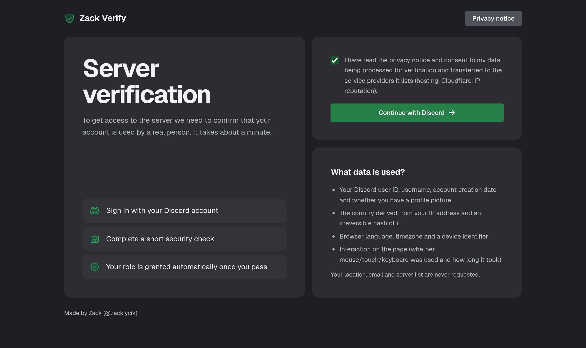
</p>

- **Stops alts and bots**: one verified identity per device and per IP block (IPv6-aware), VPN/proxy detection, browser-automation hints, account-age checks.
- **Staff stay in control**: suspicious attempts land in a channel with **Approve / Reject / Info** buttons; rejected people stay rejected until a reset.
- **Raid mode**: a join spike automatically sends every verification to manual review.
- **Privacy-minded**: IPs, devices and fingerprints are stored only as keyed hashes; records expire automatically; one command erases a person's data.
- **Small attack surface**: the website holds no data and makes no decisions. It only talks to the bot through HMAC-signed, replay-protected requests.

```
Browser ──▶ Website (Next.js, Vercel) ──signed HTTPS──▶ Bot API (Node, SQLite) ──▶ Discord roles
             no data, no decisions                       risk engine, Turnstile check,
                                                         IP lookup, staff review
```

## Screenshots

### The website

Dark and light themes follow the visitor's system setting. It is fully responsive.

<p>
  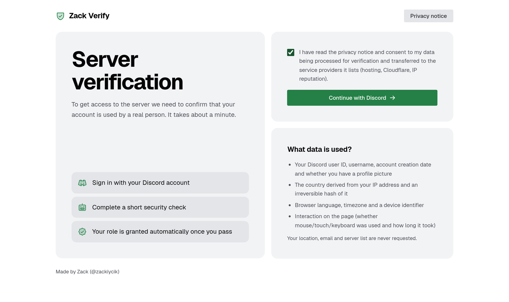
  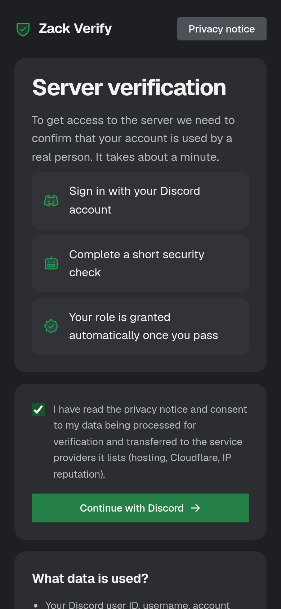
</p>

| Security check | Verified | Sent to staff review | Blocked |
|---|---|---|---|
| 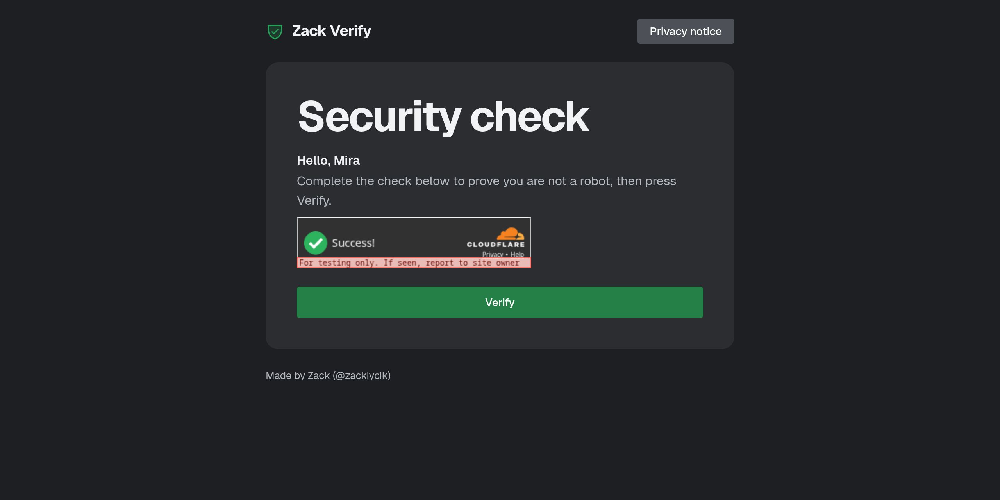 | 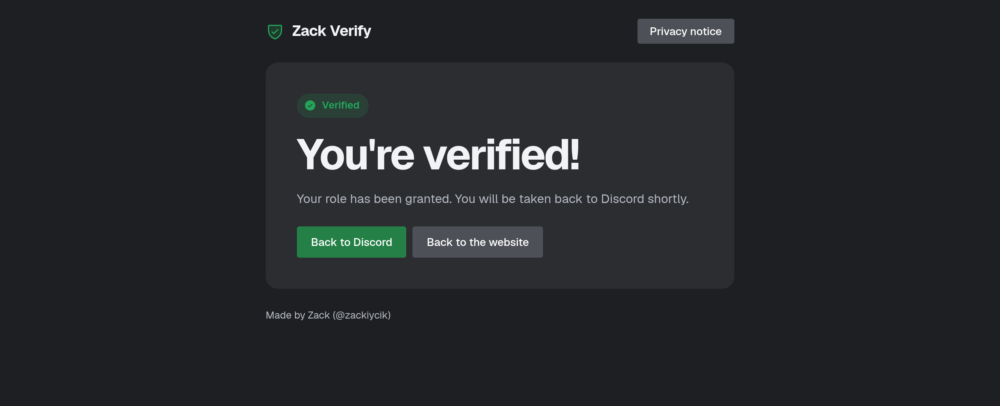 | 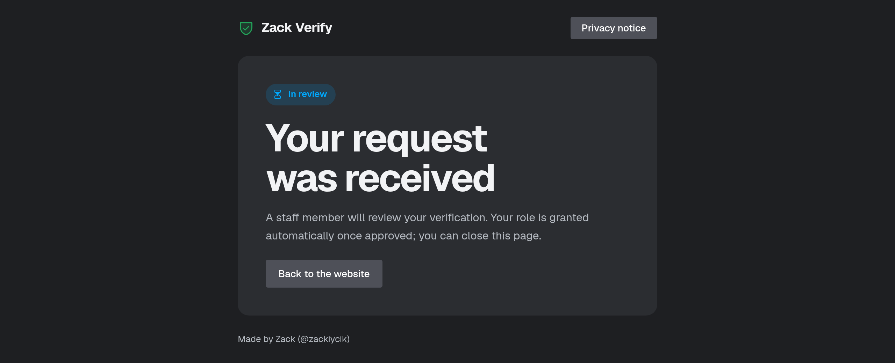 | 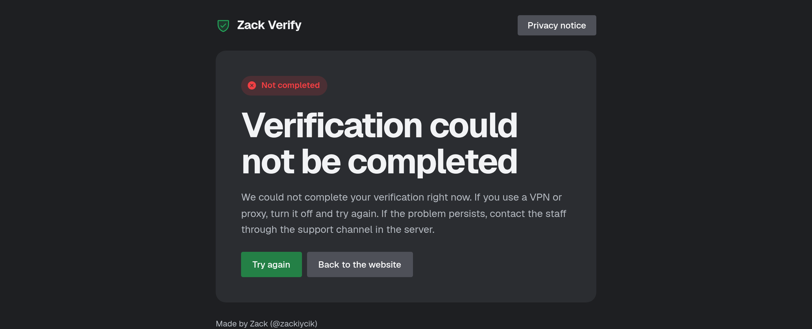 |

A visitor is never told *why* they were blocked; the reasons only go to staff.

### Inside Discord

The panel members click, and what staff see. Suspicious attempts arrive with **Approve / Reject / Info** buttons; every attempt lists the signals that were raised and how much each one counted.

<p>
  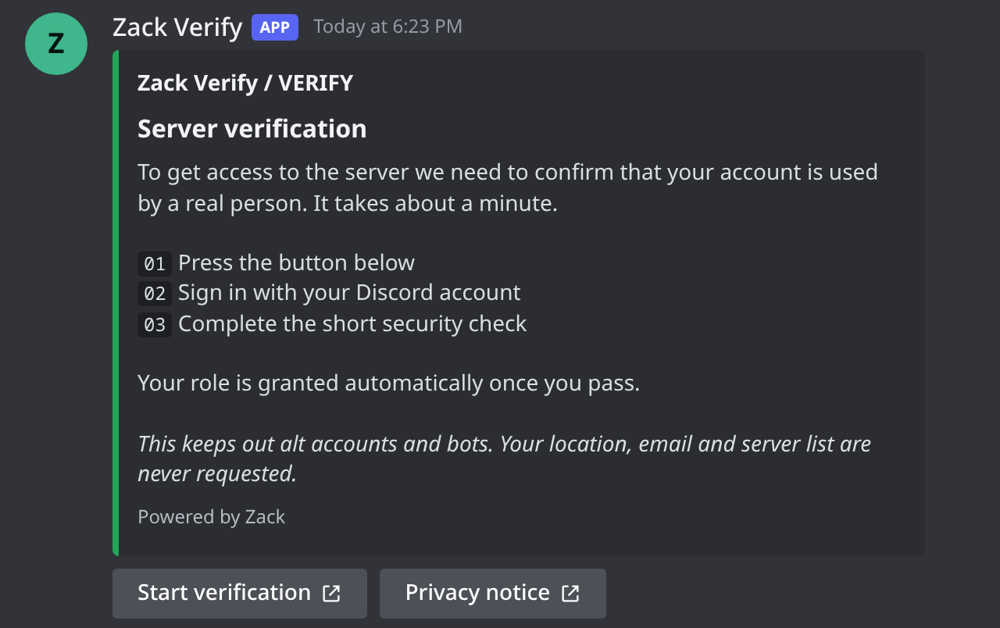
  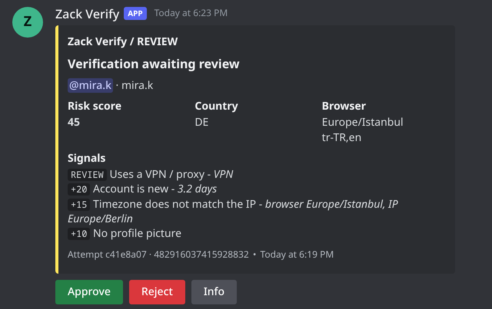
</p>
<p>
  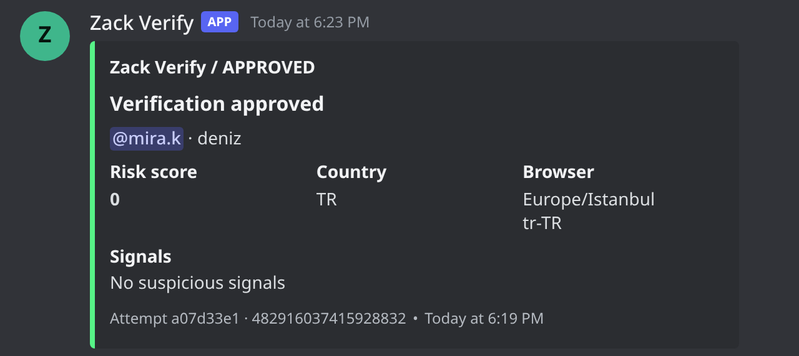
  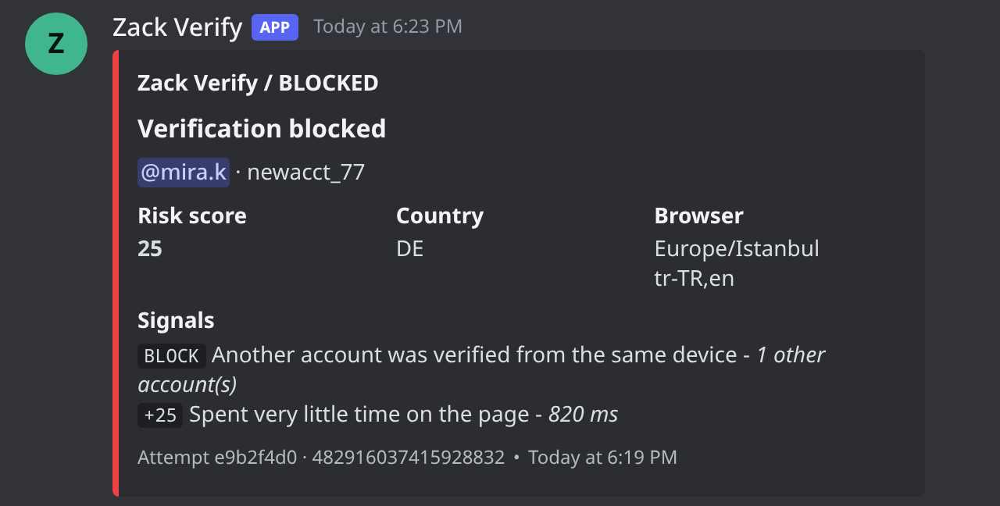
</p>
<p>
  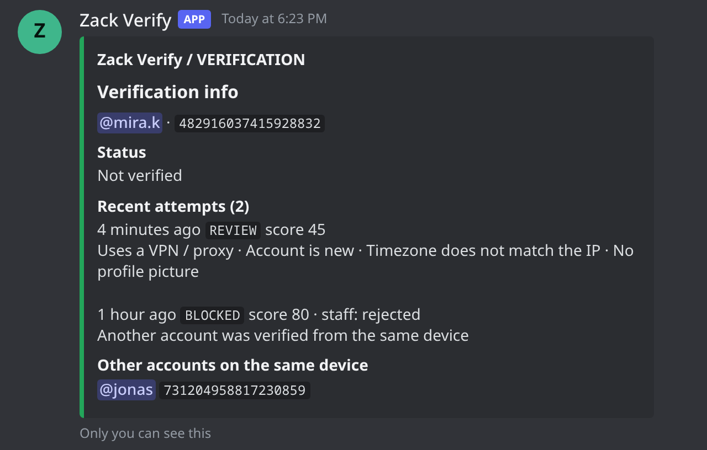
  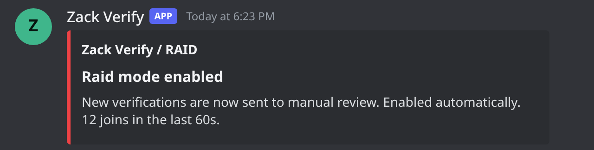
</p>

> The Discord images are the bot's real embed output (generated from the actual code with sample data) drawn in Discord's dark theme, not live captures. The security-check screenshot uses Cloudflare's test widget (hence the "for testing only" banner). Names, IDs and the server name are made up.

## What a member sees

1. Presses **Start verification** in your `#verify` channel (a link button).
2. Signs in with Discord (`identify` scope only — no email, no server list).
3. Completes the security check.
4. Gets the **Verified** role instantly, or "a staff member will review this" when something looked off.

## Requirements

- Node.js **24+** (the bot runs TypeScript directly and uses the built-in `node:sqlite`)
- A Discord application with a bot (Server Members intent enabled)
- A free Cloudflare Turnstile widget
- A place to host the website (Vercel works out of the box) and a way for it to reach the bot (tunnel such as Cloudflare Tunnel / Tailscale Funnel / ngrok, or a reverse proxy with TLS)

## Quick start

```bash
git clone <this repository> && cd zack-verify
npm run install:all

cp bot/.env.example bot/.env       # fill it in
cp web/.env.example web/.env.local # fill it in

npm run bot:deploy                 # registers the slash commands
npm run bot:start
npm run web:dev                    # http://localhost:3000
```

Then, in Discord, run `/verify-panel` in your verification channel. The full walkthrough (Discord app, roles, Turnstile, Vercel, tunnel) is in **[docs/setup.md](docs/setup.md)**.

## Staff commands

| Command | What it does |
|---|---|
| `/verify-panel` | Posts the verification panel in the current channel |
| `/verification info <user>` | Status, recent attempts with their signals, other accounts on the same device |
| `/verification approve <user>` | Verifies someone manually (skips the checks) and grants the role |
| `/verification reset <user> [remove-roles]` | Revokes verification, clears the device lock and any rejection; they can start over |
| `/verification delete <user> confirm:True` | Erases everything stored about the person |
| `/raid status \| on \| off` | Shows / forces raid mode |

Plus the **Approve / Reject / Info** buttons on review messages. Staff are members with a role in `STAFF_ROLE_IDS` or the *Manage Server* permission.

## How a decision is made

Each check returns *signals*; the engine combines them. Details and the full signal list: [docs/architecture.md](docs/architecture.md).

| Outcome | When |
|---|---|
| **Blocked** | Failed/forged Turnstile, a device token already used by another verified account, previously rejected by staff, or score ≥ `RISK_BLOCK_THRESHOLD` |
| **Manual review** | VPN/proxy, new account, shared IP or matching fingerprint, IP lookup failed, raid mode, or score ≥ `RISK_REVIEW_THRESHOLD` |
| **Approved** | Nothing suspicious |

## Repository layout

```
bot/    Discord bot + signed API + risk engine + SQLite (TypeScript, runs on Node 24)
web/    Verification website (Next.js)
docs/   Setup guide and architecture
```

## Development

```bash
npm run typecheck   # bot + web
npm test            # bot (node:test) + web (vitest)
```

See [CONTRIBUTING.md](CONTRIBUTING.md). Report vulnerabilities as described in [SECURITY.md](SECURITY.md).

## Privacy and legal

The website ships a privacy notice template (`web/src/app/privacy/page.tsx`) that describes what the stock software does. **You are the operator**: review it, set `PRIVACY_CONTACT`, and adapt it to your jurisdiction before going live.

## About the author

Made by **Zack**: [GitHub @zackiycik](https://github.com/zackiycik) · Discord `zackiycik`.

## License

Licensed under the **[PolyForm Noncommercial License 1.0.0](LICENSE)**.

- You **may** use, modify and share this software for personal use, learning, research, hobby projects, and for non-commercial communities and organizations (charities, schools, public institutions).
- You **may not** use it in anything that makes money, unless you have the author's written permission first. That includes selling it, offering it as a paid service or product, paid memberships or paid access to a server that uses it, ads, and sponsorship deals.
- **Voluntary donations are fine.** A community that only accepts donations (and gives nothing paid in return) may use it.
- Keep the license and the `Required Notice` line with every copy.

This is a *source-available* license, not an OSI-approved open source license. For commercial use, contact the author ([@zackiycik](https://github.com/zackiycik)).
